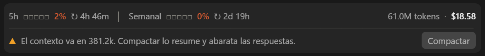

# Barra de límites para Claude Code

Un mod que dibuja una banda compacta sobre el cuadro de texto de Claude Code:

- El uso de la ventana de 5 horas y la semanal de tu plan: mini barra de 5 segmentos, porcentaje y tiempo hasta el reinicio.
- Los tokens de toda la sesión y su costo equivalente en dólares, al extremo derecho.
- Cuando el contexto pasa de 300k, un aviso con un botón **Compactar** que resume la conversación.



## Instalación

> [!TIP]
> ### La forma más fácil: pídeselo a Claude
>
> Abre Claude Code (la app de escritorio o la terminal), copia este mensaje, pégalo en el chat y envíalo:
>
> ```text
> Instala el plugin plan-limits del marketplace de GitHub mark-quispe/claude-plan-limits, con alcance de usuario.
> ```
>
> Claude hace el resto. Te pedirá permiso antes de ejecutar los comandos: acéptalo. Cuando termine, **abre una sesión nueva** y la barra aparecerá después de la primera respuesta.

> [!NOTE]
> **¿No tienes Node.js?** Pídeselo también a Claude en el mismo chat:
>
> ```text
> Instala Node.js en mi computadora.
> ```
>
> Si Windows muestra un aviso de administrador, acéptalo. Luego reinicia Claude Code. Sin Node.js la barra funciona igual, pero el contador de tokens se queda en 0.

### Requisitos

- Claude Code con un plan de suscripción (Pro o Max). Los porcentajes de 5h y semanal solo existen con un plan.
- Node.js, para el contador de tokens.

### Otras formas de instalarlo

En el prompt de una sesión de Claude Code en la terminal:

```
/plugin install plan-limits --marketplace mark-quispe/claude-plan-limits
```

Responde `y` para agregar el marketplace y elige el alcance (usuario, para todas tus sesiones).

Desde una terminal:

```bash
claude plugin install plan-limits --marketplace mark-quispe/claude-plan-limits
```

En la app de escritorio, donde `/plugin` no funciona: haz clic en **+** junto al cuadro de texto, luego **Plugins**, **Add marketplace** con `mark-quispe/claude-plan-limits`, y después **Add plugin**.

La barra aparece en una sesión nueva, tras la primera respuesta.

## Desinstalar

```bash
claude plugin uninstall plan-limits
```
